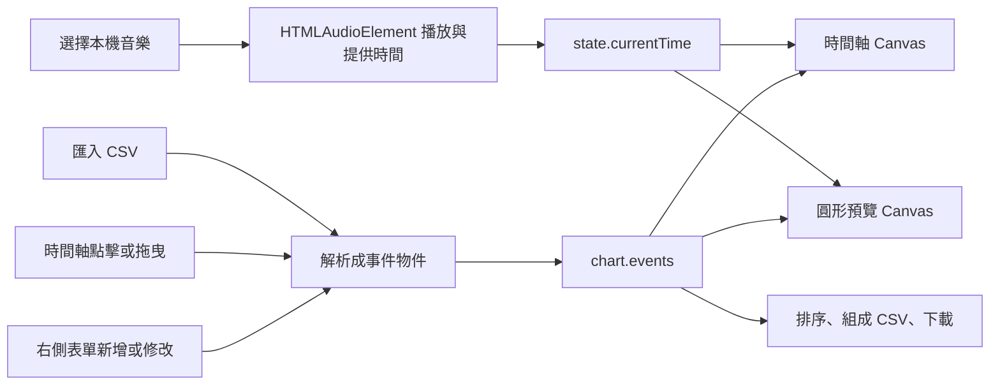

# REMINATOR VR 譜面編輯器：數學與程式邏輯教材

## 本教材怎麼讀

本教材以專案根目錄的 [chart-editor.html](chart-editor.html) 為主要範例，並對照遊戲端的 `reminator_VR/src/constants.js`、`reminator_VR/src/component.jsx` 與 `reminator_VR/src/notes.jsx`。目標不是要求你先背下所有程式，而是帶你從譜面資料開始，逐步理解時間、拍號、軌道、圓形座標、音符移動、使用者操作，以及 CSV 如何匯入編輯器、接回遊戲與匯出。

建議第一次閱讀時，先看第 1 至第 5 章；第二次打開編輯器程式，依函式名稱對照第 6 至第 10 章。最後用第 12 章的練習自己算一次，會比只讀敘述更容易建立直覺。

## 目錄

1. 編輯器的整體架構
2. 開始前要理解的基礎
3. 譜面資料模型
4. 音樂時間與拍子數學
5. 時間軸座標與縮放
6. 圓形軌道與音符半徑
7. NOTE、DRAG、ROTATE 的規則
  - 從 CSV 欄位到實際畫面位置
8. 播放、拖曳與音效同步
9. CSV 匯入與匯出
10. 從使用者操作追蹤完整資料流
11. 限制、易錯點與改善方向
12. 練習題與解答
13. 建議學習順序

## 1. 編輯器的整體架構

編譜器是單一 HTML 頁面，將 HTML、CSS 與 JavaScript 放在同一個檔案。主要工作可以分成四個部分：

| 部分 | 負責的事情 | 可以從程式中找什麼 |
|---|---|---|
| HTML | 建立音樂選取、數字欄位、按鈕、時間軸與圓形預覽的容器 | `#audio-file`、`#event-form`、`#timeline`、`#orbit-preview` |
| CSS | 控制左右欄、手機版排列、控制項尺寸與顏色 | `.layout`、`.edit-fields`、`.orbit-stage` |
| JavaScript 資料 | 保管事件和目前播放狀態 | `chart`、`state` |
| Canvas 繪圖 | 把抽象的時間和軌道資料轉成畫面 | `drawTimeline()`、`drawOrbitPreview()` |

整體流程如下：



這裡最重要的設計是：**譜面資料不是存在 Canvas 裡，而是存在 JavaScript 的 `chart.events` 陣列裡。** Canvas 只是把資料畫出來。使用者拖曳畫面時，程式先修改事件物件，再重新繪圖；匯出 CSV 時也從事件物件產生文字，而不是從像素反推資料。

這個分工很常見：資料回答「譜面是什麼」，畫面回答「資料看起來如何」。如果把資料只畫在 Canvas 上，之後就很難精確編輯、排序、刪除或匯出。

## 2. 開始前要理解的基礎

### 2.1 JavaScript 物件與陣列

一個 NOTE 會用物件表示：

```js
{
  id: "事件識別碼",
  type: "note",
  time: 1000,
  lane: 12
}
```

物件用「欄位名稱 → 值」記錄一個事件的屬性。多個事件則放在陣列中：

```js
chart.events = [noteEvent, dragEvent, rotateEvent];
```

`id` 是編輯器內部使用的識別碼，方便知道使用者正在選取哪個事件。它不會輸出到 CSV，因為遊戲格式並不需要它。

### 2.2 DOM 與事件處理

DOM 是瀏覽器提供的頁面物件模型。像 `document.querySelector('#bpm')` 是找到 BPM 欄位；接著使用 `addEventListener('change', ...)`，要求欄位改變時執行程式。

同樣地，`pointerdown`、`pointermove`、`pointerup` 對應滑鼠、觸控筆或觸控操作。編輯器使用 Pointer Events，讓桌面滑鼠和觸控裝置能共用大部分拖曳程式。

### 2.3 Canvas 與座標

Canvas 是一張由程式繪製的畫布。它只理解像素座標，例如畫布左上角是 `(0, 0)`，向右是 `x` 增加，向下是 `y` 增加。譜面本身則使用毫秒和軌道編號，所以需要「資料座標與像素座標之間的換算」。

### 2.4 數學單位

請把下面四種單位分清楚：

| 單位 | 用在哪裡 | 範例 |
|---|---|---|
| 秒 `s` | HTML 音訊的 `audio.currentTime` | `12.5` 秒 |
| 毫秒 `ms` | 譜面事件時間與 UI 顯示 | `12500` 毫秒 |
| 影格 `frame` | 遊戲每一幀讓音符移動多少 | 每幀 `0.05` 距離 |
| 像素 `px` | Canvas 上的位置 | 距離左邊 `300px` |

程式出錯時，常見原因不是公式太難，而是把單位混在一起。例如把 `12.5` 秒當成 `12.5ms`，會讓音符提早一千倍。

## 3. 譜面資料模型

編輯器以 `chart` 保存譜面整體設定，以 `state` 保存畫面和播放狀態：

```js
const chart = { offset: 0, startLane: 0, events: [] };
const state = {
  currentTime: 0,
  duration: 0,
  selectedType: 'note',
  editingId: null,
  selectedId: null,
  title: '',
  objectUrl: null
};
```

- `chart.offset`：CSV 第一列的譜面基準偏移，單位毫秒。
- `chart.startLane`：CSV 第二列的初始軌道／起始位置資料。
- `chart.events`：NOTE、DRAG、ROTATE 的事件物件陣列。
- `state.currentTime`：目前音樂游標，單位毫秒。
- `state.duration`：音檔總長，單位毫秒。
- `state.selectedType`：新增模式，例如 `note` 或 `drag`。
- `state.editingId`：若不是 `null`，代表表單正在編輯現有事件。

### 3.1 三種事件欄位

| 類型 | 主要欄位 | 意義 |
|---|---|---|
| NOTE | `time`, `lane` | 一個判定時間和一個圓周軌道 |
| DRAG | `startTime`, `endTime`, `startLane`, `endLane`, `direction` | 一段跨時間、跨軌道的連續滑動 |
| ROTATE | `time`, `direction` | 一個旋轉方向判定時間 |

三種事件使用不同欄位，是因為它們的遊戲意義不同。不要把 DRAG 的 `startTime` 和 ROTATE 的 `time` 當作同一個欄位；程式會依 `type` 決定要讀哪些值。

## 4. 音樂時間與拍子數學

### 4.1 BPM 如何換算時間

BPM 是每分鐘的拍數。編輯器目前將 BPM 解讀為「每分鐘四分音符數」。若 BPM 為 $B$，四分音符長度為：

$$
T_{quarter} = \frac{60000}{B}\text{ ms}
$$

例如 BPM = 120：

$$
T_{quarter} = \frac{60000}{120}=500\text{ ms}
$$

也就是每 500 毫秒一個四分音符。

### 4.2 音符分割與吸附

下拉選單中的 `1/4`、`1/8`、`1/16` 是音符相對於全音符的分母。編輯器以這個分母計算每格長度：

$$
T_{division}=T_{quarter}\times\frac{4}{N}
$$

其中 $N$ 是分割選項的分母。因此 BPM 120 時：

| 選項 | 一格長度 | 說明 |
|---|---:|---|
| 四分音符 `1/4` | $500\text{ ms}$ | 每個四分音符一格 |
| 八分音符 `1/8` | $250\text{ ms}$ | 一個四分音符切成兩格 |
| 十六分音符 `1/16` | $125\text{ ms}$ | 一個四分音符切成四格 |
| 三十二分音符 `1/32` | $62.5\text{ ms}$ | 一個四分音符切成八格 |

對任意時間 $t$，吸附到最近格點的公式是：

$$
t_{snap}=\max\left(0,\operatorname{round}\left(\frac{t}{T_{division}}\right)T_{division}\right)
$$

例如 BPM 120、選八分音符，格長為 250ms。使用者在 1120ms 新增事件：

$$
\operatorname{round}(1120/250)\times250=4\times250=1000\text{ ms}
$$

在 1130ms 新增則會吸附到 1250ms。最壞的四捨五入誤差約為半格，也就是這個例子中的 125ms。若選「自由編輯」，程式只把時間四捨五入成整數毫秒，不做節拍吸附。

吸附公式的原點固定在時間 0。也就是說，目前沒有另一個「格線起始偏移」參數；譜面偏移與拍線原點是兩個不同概念。

### 4.3 拍號、小節與拍線

拍號由分子和分母組成，例如 `6/8`：

- 分子 6：每小節有六個分母所代表的拍單位。
- 分母 8：每個拍單位是一個八分音符。

若 BPM 是四分音符 BPM，分母為 $D$ 的一拍長度是：

$$
T_{beat}=T_{quarter}\times\frac{4}{D}
$$

每小節長度則是：

$$
T_{bar}=M\times T_{beat}
$$

其中 $M$ 是拍號分子。以 BPM 120 的 `6/8` 為例：

$$
T_{beat}=500\times\frac{4}{8}=250\text{ ms}
$$

$$
T_{bar}=6\times250=1500\text{ ms}
$$

因此小節線位於 0ms、1500ms、3000ms……；一般拍線位於每隔 250ms 的位置。

時間軸把線分成三種外觀：

1. **灰色虛線**：方便估計經過幾秒的時間刻度。
2. **青色細線**：依拍號分母算出的拍線。
3. **綠色粗線**：每小節起點，並標示 `M1`、`M2` 等小節序號。

音符分割線和拍號拍線也不是同一件事。前者由音符分割選單決定，後者由拍號分母決定；兩者可以重疊，也可以互相穿插。縮小畫面時，程式會略過太密的小格線或普通拍線，避免畫面塞滿線條；真正新增事件時的吸附精度不會因此改變。

**目前的 6/8 慣例提醒：**程式將 BPM 固定解讀為四分音符 BPM，因此在 6/8 中每個拍線間隔是一個八分音符。部分樂理情境會把 6/8 的主拍理解成附點四分音符；若要使用那種 BPM 慣例，需要額外加入 BPM 單位選項，現在的編輯器尚未提供。

## 5. 時間軸座標與縮放

時間軸使用 Canvas 的水平像素表示時間。基準比例是每秒 90px，縮放比例記在 `timelineZoom`，範圍 0.5 到 5：

$$
PPS=90\times zoom
$$

`PPS` 是每秒像素數。Canvas 左側保留 48px 給軌道文字，所以事件時間 $t$ 毫秒的位置為：

$$
x=48+\frac{t}{1000}\times PPS
$$

例如縮放 100%、時間 2000ms：

$$
x=48+\frac{2000}{1000}\times90=228\text{ px}
$$

縮放 200% 時同一事件會在 408px。事件物件裡的時間不會改變，只有呈現位置變寬。

反過來，滑鼠點在畫布座標 $x$，時間為：

$$
t=\max\left(0,\frac{x-48}{PPS}\times1000\right)
$$

這就是為什麼縮放時必須同時調整「畫事件」和「滑鼠反算時間」兩處。如果只把音符畫大，卻仍用 90px/s 接收點擊，點擊時間就會錯誤。

### 5.1 小節、拍線的繪製節流

Canvas 不能無限制畫數萬條線。編輯器會依時間軸總長和音符分割算出可見格線數，必要時採用 stride 略過部分細線。這是視覺簡化，不是改變資料。事件的時間吸附仍使用完整的 `timeStep()`。

### 5.2 32 條軌道的垂直位置

時間軸主區共有 32 條軌道，編號為 0 至 31。畫面中的 $y$ 座標由軌道換算：

$$
y=43+(31-lane)\times7.5
$$

因此軌道 31 在最上方，軌道 0 在最下方。點擊時先將滑鼠 $y$ 換算成最近軌道，再限制在 0 至 31 之間。`clampLane()` 就是負責四捨五入與邊界限制。

## 6. 圓形軌道與音符半徑

遊戲端 `constants.js` 設定外側開始半徑 `startPosition = 4.9`，內側判定半徑 `endPosition = 1.25`。圓形預覽畫布則把遊戲單位縮放為像素：

$$
scale=\frac{R_{canvas}}{4.9}
$$

其中 $R_{canvas}$ 約為畫布寬度的 43%。遊戲半徑 $r$ 對應的畫面半徑為 $r\times scale$。這使手機與桌面畫布大小不同時，仍能保留圓環的比例。

### 6.1 音符如何往中心移動

遊戲速度 `noteSpeed` 預設為每影格 0.05 個遊戲單位。每個事件的 `triggerTime` 是抵達判定位置的時間，不是開始出現的時間。音符從 4.9 移到 1.25，總距離為：

$$
d=4.9-1.25=3.65
$$

需要的影格數為：

$$
frames=\frac{d}{speed}=\frac{3.65}{0.05}=73\text{ frames}
$$

遊戲邏輯再用 60 FPS 將影格換成毫秒：

$$
T_{travel}=frames\times\frac{1000}{60}\approx1216.67\text{ ms}
$$

因此事件時間為 $T$ 時，音符開始出現的時間是：

$$
T_{spawn}=T-T_{travel}
$$

目前時間為 $T_{now}$，經過時間為：

$$
elapsed=T_{now}-T_{spawn}
$$

距離起點的影格數為 $elapsed/(1000/60)$，目前半徑為：

$$
r=4.9-0.05\times\frac{elapsed}{1000/60}
$$

若 $T_{now}<T_{spawn}$，音符尚未出現；若 $r<1.25$，它已通過判定圈，圓形預覽便不再繪製它。這也是圓形預覽不會把整首曲子的所有音符同時擠在圓上：它顯示的是目前播放時間附近、正在進場至判定的音符。

**速度設定提醒：**編輯器目前把圓形預覽速度固定成 0.05，與遊戲的預設值一致。遊戲的側邊設定若調整了譜面速度，編輯器本身不會自動知道該值；若將來要完全一致，需要把速度也做成編輯器設定，或抽成遊戲與編輯器共用的設定檔。

## 7. NOTE、DRAG、ROTATE 的規則

### 7.1 軌道編號與圓周角度

遊戲共有 32 個軌道，完整一圈是 $2\pi$ 弧度，因此每個軌道間的角度為：

$$
\Delta\theta=\frac{2\pi}{32}=\frac{\pi}{16}=11.25^\circ
$$

軌道 `lane` 的角度可寫成：

$$
\theta=lane\times\frac{\pi}{16}
$$

在 HTML Canvas 中，螢幕的 $y$ 軸往下增加；圓形預覽因此使用負角度讓軌道方向與遊戲視覺相符：

$$
\theta_{canvas}=-lane\times\frac{\pi}{16}
$$

若把半徑 $r$ 和角度 $\theta$ 轉成平面座標：

$$
x=c_x+r\cos\theta,\qquad y=c_y+r\sin\theta
$$

其中 $(c_x,c_y)$ 是圓心。這是極座標轉直角座標，也是圓形譜面預覽最核心的幾何轉換。

遊戲 NOTE 不是單一圓點，而是有角寬的圓弧。`PREVIEW_ARC_LENGTH` 對應遊戲的 `arcLong = PI/16 + 0.4`，繪圖時用外弧和內弧組成扇形圓環。

### 7.2 NOTE

NOTE 只需時間和軌道：

```js
{ type: 'note', time: 1000, lane: 12 }
```

它在 `time - travelTime` 開始顯示，沿固定軌道角度由外往內移動，到 `time` 抵達判定圈。播放預覽的 HIT 音效則在判定時間觸發。

### 7.3 DRAG：時間和軌道都要內插

DRAG 有兩個端點：

```js
{
  type: 'drag',
  startTime: 1000,
  endTime: 2000,
  startLane: 30,
  endLane: 2,
  direction: 1
}
```

遊戲的 `density` 是 10，但兩端都算一個節點，因此實際節點數是：

$$
N=density+1=11
$$

節點索引 $i$ 從 0 到 10。每個節點的判定時間是：

$$
T_i=T_{start}+\frac{T_{end}-T_{start}}{10}i
$$

軌道位置則是沿選定方向均勻內插。先計算原始軌道差：

$$
\Delta L=L_{end}-L_{start}
$$

軌道是圓環，跨過 31 和 0 時要處理環繞。遊戲端規則如下：

- `direction = 1` 且差值為負：加 32，往軌道號碼增加的方向繞行。
- `direction = -1` 且差值為正：減 32，往軌道號碼減少的方向繞行。

接著：

$$
L_i=L_{start}+\frac{\Delta L}{10}i
$$

例如從軌道 30 移到軌道 2，原始差是 $2-30=-28$。若方向是 `1`，加 32 後變成 4，代表經過 31、0、1 到 2 的短路徑。若方向是 `-1`，原始差保留為 -28，代表沿另一方向繞大半圈。

每個 DRAG 節點也各自從外圈移到判定圈。也就是說，節點 $i$ 的半徑應使用自己的 $T_i$ 計算，而非整條 DRAG 共用同一個半徑。圓形預覽正是逐一計算這 11 個時間和軌道。

**方向欄位的重要差異：**DRAG 的 `direction = 1` 代表軌道編號增加；由 Canvas 的負角度顯示，它視覺上是逆時針。DRAG 的 `-1` 是順時針。ROTATE 使用另一套編碼：遊戲標註 `direction = 1` 為順時針，其他方向值為逆時針。雖然欄位都叫 `direction`，意思和編碼不能互換。

### 7.4 ROTATE

ROTATE 的資料是時間與方向：

```js
{ type: 'rotate', time: 3000, direction: 1 }
```

它在 `time - travelTime` 開始顯示為整圈環形音符，抵達判定時間後由遊戲檢查玩家旋轉方向。編輯器圓形預覽用藍色表示遊戲程式標註的順時針（值 1），紅色表示逆時針。

遊戲的旋轉判定還有時間窗：程式在抵達 `triggerTime` 後，使用旋轉事件判斷方向與時間差；超過 `lifeTime` 仍未命中便判定 Miss。這個編輯器的圓形預覽主要呈現音符接近判定圈，不會完整模擬玩家手部輸入或遊戲的 Perfect／Good／Miss 判定結果。

### 7.5 從 CSV 欄位到實際畫面位置

CSV 裡的 `time`、`lane` 都只是資料值，不是螢幕座標。程式需要先把文字轉成事件物件，再依照目前要畫在哪個視圖，將事件值轉換為時間軸像素、圓形預覽像素，或遊戲中的 3D 座標。三個視圖使用同一筆譜面資料，但座標系統和呈現目的不同。

以下用同一筆 NOTE 示範。假設 CSV 的偏移列是 `250`，事件列是 `note,1750,12`：

```csv
250
4
note,1750,12
```

編輯器匯入後，這筆資料的主要欄位是：

```js
{
  type: 'note',
  time: 2000, // 1750 + 250，毫秒
  lane: 12
}
```

`time` 表示事件抵達判定位置的音樂時間；`lane` 表示圓環上的軌道編號。接下來同一個 `time: 2000, lane: 12` 會被不同視圖用不同公式轉換。

#### A. 編輯器時間軸：時間與軌道轉成像素

時間軸不是把 HTML 元素一個個絕對定位，而是用 Canvas 依資料重畫。橫向代表音樂時間，縱向代表軌道。基準縮放是每秒 90px，左側保留 48px 標示時間：

$$
x=48+\frac{time}{1000}\times90
$$

軌道 0 到 31 由上往下反向排列：

$$
y=43+(31-lane)\times7.5
$$

套入 `time = 2000`、`lane = 12`：

$$
x=48+\frac{2000}{1000}\times90=228\text{ px}
$$

$$
y=43+(31-12)\times7.5=185.5\text{ px}
$$

因此 NOTE 會在時間軸 Canvas 的 `(228, 185.5)` 附近畫出來。這裡畫的是「2000ms 判定時間」對應的位置，不是音符開始出現的位置。調整時間軸縮放會改變 `pixelsPerSecond()`，所以同一筆資料的 `$x$` 像素值會變，但事件的 `time` 不變。

程式的方向是「資料值轉像素」：`timeToX(time)` 換算 `$x$`，`laneToY(lane)` 換算 `$y$`，`drawTimeline()` 再用 Canvas 的 `arc()` 畫出 NOTE。反方向操作也需要逆算：`pointerPoint()` 從滑鼠像素 `$x,y$` 推回時間與軌道，吸附及限制範圍後才更新事件物件。這樣拖曳事件才能修改資料，而不只是把畫面上的點移走。

#### B. 圓形預覽：軌道轉角度，時間決定半徑

圓形預覽中，軌道編號決定角度：

$$
	heta=-lane\times\frac{\pi}{16}
$$

負號是 Canvas 的畫面方向慣例。半徑不是固定的：它依音樂目前播放時間和事件判定時間計算。`time = 2000ms`、目前播放時間 `musicTimeMs = 1000ms` 時，音符尚未抵達判定圈，但已經從外圈往內移動。

從外圈 `4.9` 移至判定半徑 `1.25`，速度為每影格 `0.05`，在 60 FPS 下所需時間為：

$$
T_{travel}=\frac{4.9-1.25}{0.05}\times\frac{1000}{60}\approx1216.67\text{ ms}
$$

音符出現時間與目前半徑分別是：

$$
T_{spawn}=2000-1216.67=783.33\text{ ms}
$$

$$
r=4.9-0.05\times\frac{1000-783.33}{1000/60}\approx4.25
$$

圓形預覽會把 3D 半徑換成畫布像素。若畫布是 `360 × 360px`，外圈半徑約為 `360 × 0.43 = 154.8px`，比例尺是 `154.8 / 4.9 ≈ 31.59px` 每遊戲單位。於是音符的畫面半徑約為 `4.25 × 31.59 ≈ 134.3px`。軌道 12 的角度是 $-12\pi/16=-3\pi/4$，從圓心 `(180, 180)` 換算位置：

$$
x=180+134.3\cos(-3\pi/4)\approx85.1
$$

$$
y=180+134.3\sin(-3\pi/4)\approx85.1
$$

這個 `(85.1, 85.1)` 是音符圓弧所在方向和半徑的示意位置；實際繪圖會用 `orbitContext.arc()` 畫出一段有厚度的圓弧，而不是只畫一個點。圓形預覽的時間游標移動時，程式會重新算半徑並重畫，因此音符看起來像往中心飛行。

#### C. 遊戲 3D 場景：幾何、縮放、旋轉與相機

遊戲載入 CSV 後，`ProcessChoseCSVData` 將事件時間放到 `triggerTime`，軌道放到 `noteLand`，並補上 `startPosition`、`endPosition`、`noteSpeed` 等遊戲執行資料。`LogicOfNotes` 每幀讀音樂時間，使用相同的旅行時間公式算目前半徑，再把比例套在 Three.js mesh：

```js
const currentRadius = startPosition - noteSpeed * (elapsedMs / (1000 / 60));
const scale = currentRadius / startPosition;
mesh.scale.set(scale, scale, 1);
```

NOTE 的 `ringGeometry` 一開始建立在外圈半徑 `startPosition`，而 `mesh.scale` 以原點為中心縮小。因此它的目前半徑為：

$$
r_{now}=startPosition\times scale
$$

遊戲的外圈半徑是 `4.9`。以上例目前半徑 `4.25` 計算，`scale = 4.25 / 4.9 ≈ 0.867`；原本位於半徑 4.9 的圓弧縮到半徑 4.25。抵達 `triggerTime = 2000ms` 時，半徑縮到判定位置 `1.25`。

軌道透過 Three.js 的群組旋轉定位，而非直接指定一個固定的 HTML `left/top`：

```jsx
<group rotation={[0, 0, note.noteLand * everyLandAngle]}>
  <mesh>
    <ringGeometry args={[startPosition - 0.05, startPosition, 32, 1, -halfArcLong, arcLong]} />
  </mesh>
</group>
```

`everyLandAngle = π/16`，所以軌道 12 對應角度 `12 × π/16 = 3π/4`。群組旋轉會把本來放在基準方向的圓弧轉到目標軌道；mesh 縮放則控制它離中心多遠。接著 `App.jsx` 中包住遊戲物件的父群組還會設定遊戲區位置和朝向，最後由 Three.js 相機把 3D 世界座標投影成瀏覽器畫面像素。這一步的螢幕像素會受到相機、視野、畫布大小與父群組變換影響，不能直接拿時間軸上的 `(228, 185.5)` 當作 3D 座標。

可以把完整轉換想成：

```text
CSV 字串欄位
  -> 數字事件資料 { time, lane }
  -> 依播放時間算 note 半徑
  -> lane 乘每軌道角度，決定旋轉方向
  -> Three.js 幾何 + scale + group rotation 得到 3D 局部位置
  -> 父群組變換與相機投影
  -> 瀏覽器畫面中的最終像素
```

幾個容易混淆的重點：

- `time` 不是 `$x$` 座標；它只在特定時間軸縮放設定下才能換算成像素。
- `lane` 不是角度；要乘上每軌道弧度，並依所用座標系決定正負方向。
- `triggerTime` 是抵達判定圈的時間；音符會在它之前約 1216.67ms 出現並移動。
- 圓形預覽的 Canvas 像素、遊戲 Three.js 的世界單位、瀏覽器視窗像素是不同單位。換算時要知道使用哪個座標系，不可直接混用。
- 同一事件可以在時間軸上表示為一個點，在圓形預覽中表示為一段圓弧，在遊戲中表示為 3D ring mesh；變的是呈現方式，事件資料仍是同一筆。

## 8. 播放、拖曳與音效同步

### 8.1 為什麼使用音訊時鐘

真正音樂時間來自 `audio.currentTime`，它的單位是秒。程式轉成毫秒：

$$
musicTimeMs=audio.currentTime\times1000
$$

播放動畫由 `requestAnimationFrame()` 逐幀更新。每次更新時，程式把音訊時間寫到 `state.currentTime`，再呼叫 `syncTransport()` 讓時間軸、數字讀數與圓形預覽重繪。這樣時間由音訊決定，不會因為電腦畫面 FPS 忽高忽低而逐漸漂移。

### 8.2 播放與暫停

時間軸上方按鈕和圓形預覽標題列按鈕都呼叫 `togglePlayback()`，實際控制同一個 `<audio>` 元素。`play`、`pause` 事件會同步改變兩顆按鈕的圖示與無障礙標籤。

選擇音樂時，`URL.createObjectURL(file)` 建立瀏覽器可播放的本機暫存網址。音訊載入完成後，`loadedmetadata` 會取得總長並更新播放滑桿與圓形預覽。

### 8.3 沿圓周快轉與倒轉

圓形拖曳以滑鼠相對圓心的方向角度計算。若前後角度差是 $\Delta\theta$，而歌曲總長是 $D$ 毫秒：

$$
\Delta t=\frac{\Delta\theta}{2\pi}D
$$

順時針拖動使時間增加，逆時針拖動使時間減少。因為角度在 $-\pi$ 到 $\pi$ 間循環，當角度差大於 $\pi$ 或小於 $-\pi$ 時，程式會加減 $2\pi$ 修正，選擇較短的圓周方向；否則跨過正上方時可能會突然跳成倒轉大半圈。

拖曳完成後，時間會被限制在 0 到歌曲長度之間。`updatePlayhead()` 同時更新 `audio.currentTime`、編輯器的毫秒時間與 HIT 音效基準，因此拖動後不會把倒帶區段內所有 Hit 一口氣補播。

### 8.4 HIT 預覽

編輯器透過 Web Audio 載入遊戲的 `hit.wav`，預先解碼後在事件時間建立音源播放。NOTE 和 ROTATE 各有一個判定時間；DRAG 則按遊戲 11 個節點產生 11 個 Hit 時間。

每個動畫影格只播放「上一個時間」和「目前時間」之間經過的 Hit。若播放頭倒退，程式重設比較基準，不會把未來音效反向重播。HIT 勾選框只控制音效，不影響音符視覺。

## 9. CSV 匯入與匯出

### 9.1 遊戲 CSV 欄位

遊戲使用無標題列的 CSV：

```csv
偏移毫秒
起始軌道
note,相對時間毫秒,軌道
drag,相對開始毫秒,相對結束毫秒,起始軌道,結束軌道,方向
rotate,相對時間毫秒,方向
```

完整範例：

```csv
250
4
note,750,12
drag,1000,1500,30,2,1
rotate,2000,1
```

第一列 250 是譜面時間偏移，第二列 4 是遊戲起始軌道／位置。NOTE 在 CSV 中寫 750ms；載入編輯器後，顯示時間會是 $750+250=1000$ms。匯出時再用編輯時間減掉偏移，所以未修改的事件會回到 750ms。

### 9.2 為什麼要加偏移再扣偏移

遊戲載入 CSV 時，`ProcessChoseCSVData` 會把事件列的相對時間加上第一列基準值，再加上遊戲側的額外 `getOffset`：

$$
T_{game}=T_{row}+T_{csvOffset}+T_{gameOffset}
$$

編輯器載入時先將 CSV 儲存值轉成可直接編輯的譜面時間：

$$
T_{editor}=T_{row}+T_{csvOffset}
$$

匯出時再還原為相對列時間：

$$
T_{row}=T_{editor}-T_{csvOffset}
$$

這樣使用者編輯絕對播放位置時，偏移值不會不小心重複加到每個事件上。遊戲側的 `getOffset` 是另一個設定，不會被編輯器寫入事件列。

### 9.3 匯入與匯出流程

匯入流程：

1. `parseCsv()` 逐字讀取文字，處理逗號、換行、雙引號與 UTF-8 BOM。
2. `loadCsvText()` 讀取前兩列的偏移和起始軌道。
3. 每一個事件列依類型轉成 JavaScript 物件，並把 CSV 偏移加回時間。
4. 替每個事件建立內部 `id`，更新 `chart.events` 後重畫列表和 Canvas。

匯出流程：

1. `sortedEvents()` 依 NOTE／ROTATE 的時間或 DRAG 開始時間排序。
2. `buildCsv()` 寫出偏移列、起始軌道列，以及各事件欄位。
3. 匯出時間採用毫秒整數，DRAG 起點和終點都會扣掉 `chart.offset`。
4. 用 Blob 產生 UTF-8 CSV，前置 BOM 並以 CRLF 換行，觸發瀏覽器下載。

事件 ID 不會匯出。CSV 時間在匯出時四捨五入到整數毫秒，因此若表單輸入小數毫秒，匯出後會有最多約 0.5ms 的捨入差。

### 9.4 在 Chart Studio 匯入現有 CSV

編輯器匯入的是「電腦上的 CSV 檔案」，不會自動搜尋遊戲歌曲清單，也不會直接改寫專案檔案。請依序操作：

1. 在瀏覽器直接開啟工作區根目錄的 `chart-editor.html`，即可選取本機音樂和 CSV。若要讓 HIT 預覽音效也載入，請用靜態伺服器從工作區根目錄提供此頁面，因為音效路徑是 `./reminator_VR/src/assets/hit.wav`。注意：直接在 `reminator_VR/` 執行預設 `npm run dev` 時，Vite 根目錄是 `reminator_VR/`，不會提供上一層的 `chart-editor.html`。
2. 按左側「選擇音樂檔案」，選擇要對譜的音檔。這會設定播放音訊與歌曲名稱；音檔只在瀏覽器中作為本次編輯的播放來源。
3. 按「匯入既有 CSV 譜面」，選擇要修改的 `.csv`。成功後，事件會出現在中央時間軸、右側事件清單與下方圓形預覽。
4. 檢查偏移、起始軌道、BPM、拍號及分割設定。匯入會套用 CSV 前兩列的偏移與起始軌道；BPM、拍號和分割則是編輯器的顯示／吸附設定，不存在於這個 CSV 格式中，需要依歌曲另外設定。

#### 9.4.1 畫面上的「按鈕」如何打開檔案選擇器

HTML 的核心不是一般的 `<button>`，而是兩個互相連結的元素：

```html
<label class="file-button" for="csv-file">匯入既有 CSV 譜面</label>
<input id="csv-file" type="file" accept=".csv,text/csv">
```

- `input type="file"` 是瀏覽器原生的檔案選擇控制項。使用者選檔後，瀏覽器會把選到的檔案放進它的 `files` 清單。
- `id="csv-file"` 提供這個輸入欄位的識別名稱。
- `label for="csv-file"` 指向同一個 ID。點擊標籤會觸發對應的檔案選擇器，因此可以把外觀設計成一般按鈕。
- `accept=".csv,text/csv"` 是檔案選擇器的提示，讓它優先顯示 CSV 檔。這不是安全檢查，也不能保證檔案內容真的符合 CSV 格式；程式仍要解析與驗證內容。
- CSS 的 `#audio-file, #csv-file { display: none; }` 隱藏原生控制項，但不會移除它。標籤仍可以透過 `for` 找到欄位並觸發它。

這個設計把「選檔」和「按鈕外觀」分開：HTML 負責選檔行為，CSS 負責外觀，JavaScript 負責處理選到的檔案。一般網頁不能在沒有使用者操作的情況下任意讀取電腦檔案；使用者需要親自選擇檔案，瀏覽器才會提供該檔案的存取權。

#### 9.4.2 `change` 事件與 `File` 物件

目前的事件處理程式是：

```js
document.querySelector('#csv-file').addEventListener('change', async (event) => {
  const file = event.target.files[0];
  if (!file) return;
  try {
    loadCsvText(await file.text(), file.name);
  } catch (error) {
    showToast(error.message);
  }
  event.target.value = '';
});
```

逐行看資料怎麼流動：

1. `document.querySelector('#csv-file')` 找出 HTML 中 ID 是 `csv-file` 的檔案欄位。
2. `addEventListener('change', ...)` 登記事件處理函式。使用者完成選檔後，瀏覽器觸發 `change`，並把事件物件傳入函式。
3. `event.target` 是觸發事件的 `<input>`；`event.target.files` 是 `FileList`，其中每一項都是 `File` 物件。這裡只接受一個檔案，所以讀索引 `[0]`。
4. 使用者按取消時，可能沒有檔案，因此 `if (!file) return` 直接結束，避免讀取不存在的檔案。
5. `file.name` 是檔名；`file.text()` 則非同步讀取檔案內容，回傳一個 Promise，完成後得到字串。
6. `await` 等待文字讀取完成，再把文字交給 `loadCsvText()`。`async` 讓事件處理函式可以使用 `await`，而讀取期間不會凍結整個瀏覽器畫面。
7. `try/catch` 接住讀檔或解析時丟出的錯誤，並透過 Toast 顯示訊息。
8. 最後將 `input.value` 清空，讓使用者之後再次選到同一個檔案時，瀏覽器仍會再觸發 `change`。這不會刪除電腦上的檔案，也不會清空已匯入的 `chart.events`。

`File` 不是檔案路徑字串，也不是 CSV 內容本身。它是一個代表使用者授權選取之檔案的瀏覽器物件，提供 `name`、`size`、`type`、`text()` 等資訊或方法。這份編輯器採用「讀成文字，再自己解析」的流程；沒有使用 `fetch()` 上傳檔案，也沒有把本機路徑寫進專案。

#### 9.4.3 從 CSV 文字解析成列與欄

讀檔後，`parseCsv(text)` 將文字轉為二維陣列。以這段內容為例：

```csv
250
4
note,750,12
rotate,2000,1
```

解析結果的結構近似：

```js
[
  ['250'],
  ['4'],
  ['note', '750', '12'],
  ['rotate', '2000', '1']
]
```

外層陣列代表列，內層陣列代表該列的欄位。因此 `rows[2][0]` 是第三列第一欄的 `note`，`rows[2][1]` 是第二欄的 `750`。程式從索引 0 開始計數：CSV 的第一列是 `rows[0]`，不是 `rows[1]`。

CSV 不能只用 `text.split(',')` 解析，因為欄位可能被雙引號包住，欄位文字也可能包含逗號或換行。這個專案的 `parseCsv()` 逐字掃描輸入字串，使用 `quoted` 記錄目前是否位於雙引號欄位內：

```js
if (quoted) {
  if (character === '"' && source[index + 1] === '"') {
    cell += '"';
    index += 1;
  } else if (character === '"') {
    quoted = false;
  } else {
    cell += character;
  }
} else if (character === '"') {
  quoted = true;
} else if (character === ',') {
  row.push(cell);
  cell = '';
} else if (character === '\n' || character === '\r') {
  // 完成一列；CRLF 會一起略過
} else {
  cell += character;
}
```

重要觀念是：只有在 `quoted === false` 時，逗號才代表欄位結束、換行才代表資料列結束。`"A,B"` 中間的逗號屬於欄位內容，不應切成兩欄；CSV 用 `""` 表示欄位內的一個雙引號。解析器也會先移除檔案開頭可能出現的 UTF-8 BOM，並略過完全空白的列。這裡的程式片段省略了陣列初始化、最後一列收尾等細節；完整實作請看 `chart-editor.html` 的 `parseCsv()`。

此函式輸出的是「字串陣列」，還不是遊戲事件物件。CSV 文字 `750` 仍是字串 `'750'`；下一步才會依照欄位用途轉成數字。

#### 9.4.4 將每一列轉成有意義的 JavaScript 物件

`loadCsvText()` 先呼叫 `parseCsv()`，再讀取標頭兩列：

```js
const rows = parseCsv(text);
const offset = Number(rows[0][0]);
const startLane = Number(rows[1][0]);
const events = [];
```

`Number(...)` 把文字數字轉成 JavaScript 數字；`events` 是暫存陣列，接下來每解析成功一列，就加入一個事件物件。事件列從 `rows.slice(2)` 開始，因為前兩列是譜面設定，不是音符：

```js
for (const row of rows.slice(2)) {
  const type = row[0]?.trim();

  if (type === 'note') {
    events.push({
      id: crypto.randomUUID(),
      type,
      time: Number(row[1]) + offset,
      lane: Number(row[2]),
    });
  }
}
```

例如 `row` 是 `['note', '750', '12']`，`offset` 是 `250`：

| 表達式 | 值 | 為什麼 |
|---|---:|---|
| `row[0]` | `'note'` | 第一欄是事件類型 |
| `Number(row[1])` | `750` | 第二欄轉成毫秒數字 |
| `Number(row[1]) + offset` | `1000` | 把 CSV 相對時間轉成編輯器使用的時間 |
| `Number(row[2])` | `12` | 第三欄轉成軌道號碼 |

最後加入的 NOTE 物件是：

```js
{
  id: '每次匯入時新產生的 UUID',
  type: 'note',
  time: 1000,
  lane: 12
}
```

物件比「某列的第幾欄」更容易使用：後續程式可以寫 `event.time`、`event.lane`，不必到處記住索引 1 和索引 2。`type` 用來辨識事件種類；`id` 是編輯器內部識別碼，讓選取、修改、刪除能鎖定同一個事件。UUID 不會匯出，因為遊戲 CSV 不需要編輯器的選取識別碼。

其他事件依類型採用不同欄位：

```js
// CSV: drag,1000,1500,30,2,1
{
  id: '...', type: 'drag',
  startTime: 1250, endTime: 1750,
  startLane: 30, endLane: 2, direction: 1
}

// CSV: rotate,2000,1
{
  id: '...', type: 'rotate',
  time: 2250, direction: 1
}
```

這兩例同樣假設 `offset` 是 `250`。DRAG 用起訖時間與起訖軌道描述一段移動；ROTATE 用一個時間和方向描述旋轉判定。因此資料型別不同時，欄位形狀也不同，不能把所有事件硬塞進同一組欄位。

#### 9.4.5 驗證、暫存與更新畫面

匯入不是一讀到一列就立刻改畫面。程式先在區域變數 `events` 裡逐列解析；遇到無法辨識的類型或非數字欄位就 `throw new Error(...)`，停止匯入。所有列完成後才把暫存結果交給主要資料：

```js
chart.offset = offset;
chart.startLane = Math.min(31, Math.max(0, Math.round(startLane)));
chart.events = events;
renderAll();
```

這種「先解析到暫存資料，成功後再提交」的想法，可以避免半份資料被畫進編輯器。`renderAll()` 不負責解析 CSV；它根據已更新的 `chart.events` 重畫事件清單和兩個 Canvas。資料是來源，畫面是資料的呈現結果。

要分清楚三種不同的檢查：

1. `accept=".csv,text/csv"` 是檔案選擇器提示，不驗證內容。
2. `loadCsvText()` 目前會檢查前兩列是否可轉成有限數字、事件類型是否辨識、主要數字欄是否可轉成有限數字。
3. 表單的 `formToEvent()` 會檢查事件時間、軌道範圍等規則；但匯入目前沒有完整呼叫同一套表單驗證。因此「能成功匯入」不代表每一列都符合所有遊戲規則，例如 NOTE 軌道在 CSV 匯入時目前沒有明確限制為 0–31。發現異常時，請在時間軸／表單確認資料並在遊戲實際測試。

匯入程式大致經過以下資料轉換：

```text
選取 File
  -> await file.text() 讀成文字
  -> parseCsv(text) 解析為列與欄的二維陣列
  -> loadCsvText() 驗證標頭及事件欄位
  -> chart.events = [{ id, type, ...事件欄位 }]
  -> renderAll() 更新清單與畫布
```

例如這一列：

```csv
note,750,12
```

會轉成近似以下的 JavaScript 物件（`id` 每次匯入時重新產生）：

```js
{ id: '新產生的識別碼', type: 'note', time: 1000, lane: 12 }
```

這裡假設第一列偏移是 `250`，所以編輯器時間是 `750 + 250 = 1000ms`。Canvas 只負責顯示這個物件；資料真正存放在 `chart.events`，所以編輯、刪除和匯出都是操作事件資料，而不是修改圖片。

### 9.5 編輯匯入的事件

你可以用事件清單或時間軸選取事件，兩者最後都會操作 `chart.events` 中同一筆資料：

| 操作 | 怎麼做 | 程式中發生什麼事 |
|---|---|---|
| 選取並跳到事件 | 點右側事件列 | 設定 `state.selectedId` 和 `state.currentTime`，並同步音訊播放位置 |
| 修改精確欄位 | 點事件列的編輯圖示，改右側表單後按「儲存變更」 | `FormData` 收集欄位，`formToEvent()` 驗證後以相同 ID 更新事件 |
| 在時間軸新增 NOTE | 選 NOTE，在上方軌道區點擊 | 時間吸附到目前分割，軌道限制在 0–31，新增事件後開啟表單 |
| 在時間軸新增 DRAG | 選 DRAG，在軌道區按住並拖曳 | 起點、終點時間與軌道被記錄；方向依軌道變化推定，之後可在表單調整 |
| 在時間軸新增 ROTATE | 選 ROTATE，在下方 ROTATE 區點擊 | 建立時間與方向事件，並開啟表單 |
| 直接移動事件 | 在時間軸抓住事件並拖曳 | 以游標位移換算時間與軌道，再套用吸附和軌道邊界限制 |
| 刪除事件 | 點事件列的刪除圖示 | 用 `filter()` 建立不包含該 ID 的新陣列 |

`formToEvent()` 是資料驗證邊界：時間必須是非負數；DRAG 結束時間必須晚於開始時間；NOTE 與 DRAG 軌道必須是 0 到 31 的整數。表單上的 `min`、`max` 屬性只協助瀏覽器輸入，真正的程式檢查仍在 `formToEvent()`。

注意：在時間軸直接拖曳現有事件會立刻改動資料；要取消尚未匯出的修改，可以重新匯入原始 CSV。編輯器目前沒有自動儲存或復原歷史，因此建議保留原始檔，並使用不同檔名匯出新版本。

### 9.6 把 CSV 加入遊戲專案並讓遊戲載入

只在編輯器選到 CSV，並不代表遊戲已經知道這首歌。遊戲的歌曲清單是從 `reminator_VR/public/VRsongData.json` 載入，而每筆歌曲資料的 `csv` 欄位告訴遊戲要去哪裡讀譜。

建議在 `reminator_VR/public` 建立 `charts` 資料夾，將 CSV 放在其中，例如：

```text
reminator_VR/
  public/
    VRsongData.json
    charts/
      practice-chart.csv
```

在 Vite 專案中，`public` 目錄的檔案會以網站根路徑提供。因此這個檔案的 URL 是 `/charts/practice-chart.csv`，不是 `/public/charts/practice-chart.csv`。遊戲的 `LoadData` 以 `fetch('/VRsongData.json')` 讀取歌曲清單，選歌後 `ProcessChoseCSVData` 再以 `fetch(getChose.csv)` 讀取 CSV。

在 `VRsongData.json` 的陣列中新增一筆歌曲物件。至少要提供遊戲使用的欄位；圖片和音樂也必須是可存取的網址或 `public` 路徑：

```json
{
  "id": 100,
  "name": "Practice Chart",
  "song_artist": "Artist",
  "sheet_artist": "Mapper",
  "level": 1,
  "bpm": 120,
  "mp3": "/audio/practice-song.mp3",
  "csv": "/charts/practice-chart.csv",
  "img": "/images/practice-cover.jpg"
}
```

請確認 `id` 沒有和其他歌曲重複，並確認 `mp3`、`csv`、`img` 指向的檔案真的存在。若只想測試譜面，也可沿用已有歌曲的音樂與圖片，但 `csv` 要指向新譜面。

遊戲端讀取 CSV 的核心流程如下：

```text
VRsongData.json 的歌曲物件
  -> 選歌後取得 getChose.csv
  -> fetch(csv URL) 下載文字
  -> Papa.parse(..., dynamicTyping: true) 轉成列資料
  -> 從第 3 列起依 note / drag / rotate 欄位建立資料
  -> 加上 CSV 偏移和遊戲額外偏移
  -> 加入速度、出生半徑、判定旗標等遊戲執行資料
  -> setNoteCSVData(processedNotes)
  -> App.jsx 依 type 分給對應的音符邏輯元件
```

例如 `type === 'note'` 時，載入器把 CSV 的相對時間加上第一列偏移與遊戲 `getOffset`，並將軌道欄位命名為 `noteLand`。接著 NOTE、DRAG、ROTATE 分別會被篩選到 `onlyNotes`、`onlyDrag`、`onlyRotate`，再傳給 `LogicOfNotes`、`LogicOfDarg`、`LogicOfRotate`。因此 CSV 欄位名稱和順序必須符合遊戲格式；`note`、`drag`、`rotate` 都是小寫固定字串。

### 9.7 完整往返：匯入、編輯、匯出、遊戲測試

1. 複製一份原始 CSV 作為備份，再於 Chart Studio 選擇對應音樂並匯入 CSV。
2. 在清單選取事件，或在時間軸新增／拖曳事件；用右側表單精確調整時間、軌道和方向。
3. 按「匯出遊戲 CSV」，確認下載檔名與內容。若偏移是 `250`，而事件在編輯器顯示 `1000ms`，匯出事件列時間應是 `750ms`。
4. 將匯出的 CSV 放入 `reminator_VR/public/charts/`，並在 `VRsongData.json` 的歌曲物件設定相符的 `csv` URL。
5. 啟動遊戲，選取歌曲並測試選單、音樂、NOTE／DRAG／ROTATE 的判定。開發伺服器下可直接開啟 `http://localhost:<Vite埠號>/charts/practice-chart.csv`，確認伺服器能回傳 CSV 文字。

若遊戲仍載入舊譜，先確認歌曲物件的 `csv` 路徑是否正確、瀏覽器是否能開啟該 URL，以及歌曲是否真的選到新資料。若預覽和遊戲判定時間不一致，檢查第一列 CSV 偏移與遊戲側額外譜面偏移；兩者會相加，不能把同一偏移重複寫入兩處。

### 9.8 匯入錯誤與排查

| 現象 | 常見原因 | 檢查方式 |
|---|---|---|
| 編輯器顯示匯入失敗 | 缺少前兩列、偏移／起始軌道不是數字、事件列欄位不完整 | 確認前兩列各有數字，並逐列核對第 9.1 節格式 |
| 編輯器匯入後沒有歌曲聲音 | 只匯入 CSV，尚未選音樂檔 | 另外按「選擇音樂檔案」載入對應音檔 |
| 遊戲歌曲清單沒有新曲目 | 沒有編輯 `public/VRsongData.json`，或 JSON 語法錯誤 | 確認是合法 JSON 陣列、逗號與雙引號正確，並重新載入頁面 |
| 遊戲載入不到譜面 | `csv` URL 不存在或路徑錯誤 | 用瀏覽器直接開啟該 URL；`public` 不要放進 URL |
| 音符時間整體偏移 | CSV 第一列與遊戲額外偏移相加，或匯出後偏移被重複加回 | 對照 $T_{game}=T_{row}+T_{csvOffset}+T_{gameOffset}$ |
| 部分事件未出現 | 類型字串大小寫錯、欄位順序錯，或列資料不符合事件類型 | `note`／`drag`／`rotate` 使用小寫，按第 9.1 節逐欄檢查 |

目前遊戲端以 `Papa.parse()` 解析資料，但主要載入程式沒有檢查 `response.ok`，也沒有把每種 CSV 列逐一驗證後回報到畫面；發生格式錯誤時，請同時查看瀏覽器開發者工具的 Console 與 Network。Chart Studio 有自己的格式檢查，但「編輯器成功匯入」仍不等於「遊戲端一定能正常載入」，最後要在遊戲中實際測試。

## 10. 從使用者操作追蹤完整資料流

### 10.1 在時間軸新增 NOTE

1. 使用者選擇 NOTE 模式並在 32 條軌道區點擊。
2. `pointerPoint()` 將滑鼠位置換算成時間和軌道。
3. 時間呼叫 `snappedTime()` 對齊音符分割；軌道呼叫 `clampLane()` 限制在 0 至 31。
4. 建立 NOTE 物件並推入 `chart.events`。
5. `updatePlayhead()` 移到該事件時間，`openEventEditor()` 打開右側精確表單。
6. `renderAll()` 更新事件清單、時間軸和圓形預覽。

### 10.2 在時間軸畫 DRAG

1. 選 DRAG 模式，在某個軌道按下，這形成起點。
2. `setPointerCapture()` 讓使用者把游標拖出 Canvas 邊界時仍然收到移動事件。
3. 每次 `pointermove` 更新時間與軌道，並吸附至格線。
4. 起點時間大於終點時，程式會交換起訖時間和起訖軌道，維持 `startTime < endTime`。
5. 根據軌道增減自動設定方向，再由使用者於表單精修。
6. 放開滑鼠後確認最短長度至少一格，選取事件並開啟表單。

### 10.3 在圓形預覽拖時間

1. 按下圓周位置，記錄相對圓心角度。
2. 拖動時算出前一角度與目前角度差。
3. 修正跨越 $\pi$ 的角度循環問題。
4. 依歌曲總長將角度差換算成毫秒差。
5. 更新 HTML 音訊時間和編輯器游標。
6. 同一時間值重新繪製時間軸和圓形預覽。

## 11. 限制、易錯點與改善方向

### 11.1 方向編碼依事件類型而異

不要看到 `direction` 就假設數值 1 永遠代表同一方向。DRAG 的 1／-1 描述軌道差如何沿 32 個軌道環繞；ROTATE 的 1／2 則表示遊戲的旋轉方向判定。閱讀 CSV 或改程式時，先確認 `type`。

### 11.2 BPM、拍號和拍線起點

目前 BPM 以四分音符為單位；拍號選擇只會更新拍線與小節線，不會改變 CSV 事件，也不會更改音符吸附的時間原點。編輯器還沒有支援變速曲、變拍號段落、弱起小節或小節起點偏移。這些功能都需要為時間軸定義新的時間區段資料，而不是單純多加一條畫線。

### 11.3 圓形預覽速度

圓形預覽固定使用遊戲常數 4.9、1.25、0.05 和 60 FPS。遊戲目前 `getSpeed` 預設同為 0.05；若玩家或遊戲側調整速度，預覽和遊戲的音符進場時間便可能不同。長期建議把共同參數搬到共享 JSON 或 ES Module，讓遊戲與編輯器引用同一份來源。

### 11.4 圓形預覽不是遊戲模擬器

它按照遊戲的半徑和軌道畫出正在移動的音符，但沒有載入 Three.js 場景、VR 控制器、玩家方向、碰撞判定或遊戲中的完整結果系統。它適合檢視譜面事件、軌道、方向和進場時間，不應拿來替代遊戲實測。

### 11.5 資源路徑與瀏覽器安全

HIT 音效讀取 `./reminator_VR/src/assets/hit.wav`。若把 `chart-editor.html` 移到別處，需保留相對路徑或調整音效路徑。使用本機音樂和 CSV 會由使用者明確挑選檔案；載入 HIT 音效則使用頁面相對路徑。建議透過本機 HTTP 伺服器開啟，不要假設所有瀏覽器都允許 `file://` 頁面讀取相鄰資源。

### 11.6 資料校驗

`formToEvent()` 會檢查時間非負、DRAG 結束晚於開始、NOTE／DRAG 軌道為 0 至 31 的整數。修改功能時，新增欄位也應加入驗證；畫布的滑鼠座標要驗證，CSV 匯入也要驗證，不能只依賴瀏覽器的 `min`、`max` 屬性。

## 12. 練習題與解答

### 練習一：算八分音符格長

BPM 150，選擇八分音符。每格多少毫秒？

**解答：**

$$
T_{quarter}=60000/150=400\text{ ms}
$$

$$
T_{1/8}=400\times4/8=200\text{ ms}
$$

### 練習二：吸附時間

BPM 150、八分音符格線，在 930ms 新增 NOTE，會吸附到哪裡？

**解答：**格長 200ms，$930/200=4.65$，四捨五入成 5，因此時間是 $5\times200=1000$ms。

### 練習三：6/8 小節長度

BPM 120，拍號 6/8。一小節幾毫秒？

**解答：**四分音符 500ms，八分拍長 $500\times4/8=250$ms，小節長 $6\times250=1500$ms。

### 練習四：音符何時出現

NOTE 判定時間是 5000ms，速度 0.05，起點 4.9、終點 1.25。它何時出現？

**解答：**移動需要 $((4.9-1.25)/0.05)\times(1000/60)=1216.67$ms。出現時間約為 $5000-1216.67=3783.33$ms。

### 練習五：軌道環繞

DRAG 從軌道 30 到軌道 2，方向為 1。最短差值是多少？

**解答：**原差為 $2-30=-28$。方向 1 且差值為負時加 32，得到 4；程式會沿增加軌道編號的方向跨過 31／0。

### 練習六：畫面座標

縮放 150%，時間軸事件時間為 3000ms。事件的 Canvas $x$ 大約是多少？

**解答：**每秒像素為 $90\times1.5=135$。所以 $x=48+3\times135=453$px。

## 13. 建議學習順序

若你想自己擴充編輯器，建議按以下順序學習：

1. **JavaScript 基礎**：變數、函式、物件、陣列、條件判斷、排序、`map()`、`filter()`。
2. **HTML 表單與 DOM**：`input`、`select`、`FormData`、`querySelector()`、`addEventListener()`。
3. **CSS Grid 與 Flexbox**：理解兩欄欄位、響應式排版、元件尺寸。
4. **時間單位與離散取樣**：秒、毫秒、影格、`requestAnimationFrame()`、音訊播放時鐘。
5. **Canvas 2D**：線條、圓弧、文字、縮放與裝置像素比。
6. **三角函數與極座標**：弧度、正弦、餘弦、角度跨界、圓周方向。
7. **資料格式與序列化**：CSV 引號、換行、BOM、匯入驗證、格式往返。
8. **測試與除錯**：先寫可手算的小案例，再做匯入／匯出往返測試，最後才測整個播放流程。

推薦在修改程式時採取「一次只改一個換算」的方式。例如先只改每秒像素值，確認繪製與反算滑鼠時間一致，再調整 Canvas 尺寸。時間、角度、半徑和像素各有自己的單位；每個函式都清楚標示輸入與輸出的單位，會讓譜面程式容易除錯很多。

## 14. 更深入的程式寫法與設計觀念

前面章節已經講到「資料」、「畫布」、「時間換算」和「CSV 格式」，這些概念是編譜器最核心的骨架。真正能寫出穩定、好維護的譜面工具，不只是會算公式，而是要懂得把複雜邏輯拆成小函式、把狀態與畫面分開、並且讓每一個資料流都能被驗證。

### 14.1 資料先行，畫面後繪製

一個譜面編輯器最容易踩坑的地方，是把「事件物件」和「畫面像素」混在一起。這種錯誤往往是這樣發生的：你在 Canvas 上按一下，立刻直接用 `x`, `y` 計算音符位置，然後把結果塞進 DOM 或全域變數，最後再想辦法拼出 CSV。這樣做的問題不是不能用，而是資料會變成「看起來像有內容，但沒有明確格式」。

比較好的寫法是：

```js
const event = {
  id: crypto.randomUUID(),
  type: 'note',
  time: 1250,
  lane: 12
};

chart.events.push(event);
renderAll();
```

在這個架構裡，`event` 是唯一真相；`renderAll()` 只是把它畫在 Canvas 上，或顯示在列表中。也就是說：

- 資料本身知道「什麼時候、哪一條軌道」
- 畫面知道「畫在哪裡」
- CSV 知道「怎麼輸出成檔案」

這三種責任分離非常重要。因為一旦你讓畫圖結果直接變成資料來源，後續的排序、刪除、匯出、還原、編輯就會變得很難。這類程式大多會出現「明明資料看起來一樣，卻因為畫面重計算而掉值」這種十分惱人的問題。

### 14.2 `chart` 和 `state` 各自扮演什麼角色

在編輯器裡，`chart` 是資料層，`state` 是 UI／播放狀態層。這種分層很重要，因為譜面資料和使用者操作狀態不是同一件事。

```js
const chart = {
  offset: 250,
  startLane: 4,
  events: []
};

const state = {
  currentTime: 0,
  duration: 180000,
  selectedType: 'note',
  editingId: null,
  selectedId: null,
  timelineZoom: 1,
  isPlaying: false
};
```

這裡的區別是：

- `chart.offset`、`chart.startLane`、`chart.events` 是譜面本身
- `state.currentTime`、`state.isPlaying`、`state.timelineZoom` 是當前視窗狀態
- 兩者會互相影響，但不該混成同一個物件

這對除錯很有幫助，因為你可以把「譜面是否正確」和「畫面是否正在播放」分開檢查。若介面卡住，但 `chart.events` 仍然正確，問題通常在 `state` 或事件綁定；若事件資料錯了，則問題一般在 `parseCsv()`、`formToEvent()` 或 `sortEvents()`。

### 14.3 把複雜邏輯拆成小函式

一個大型編輯器常常會變得很長，原因是很多邏輯都是「先寫出一大段流程」，結果最後只剩 `updateEverything()` 這種大雜燴。這種寫法雖然短期快，但長期維護性很差。

比較好的做法是把事情分成明確的小函式：

```js
function snappedTime(t, division) {
  const step = beatLength() * (4 / division);
  return Math.round(t / step) * step;
}

function clampLane(lane) {
  return Math.max(0, Math.min(31, Math.round(lane)));
}

function timeToX(ms, zoom) {
  const pixelsPerSecond = 90 * zoom;
  return 48 + (ms / 1000) * pixelsPerSecond;
}
```

每個函式的責任都很小：

- `snappedTime()` 只負責吸附時間
- `clampLane()` 只負責限制軌道號碼
- `timeToX()` 只負責把毫秒轉成畫布座標

這種呼叫方式的好處是：你在 debug 時可以直接隔離問題來源，並且容易做單元測試。比如你只需要卡在 `timeToX()`，就不必看整個播放流程；你只要確認輸入 2000ms 和 zoom 1.5 結果是 48 + 3*135 = 453px 即可。

### 14.4 將「使用者操作」轉成「資料變更」

編輯器的大多數操作不是直接改畫面，而是先改資料，再由資料驅動畫面重繪。這是事件驅動編程的核心概念。

舉例：使用者在時間軸點擊新增 NOTE。

```js
const point = pointerPoint(clientX, clientY);
const event = {
  id: createId(),
  type: 'note',
  time: snappedTime(point.time, state.division),
  lane: clampLane(point.lane)
};

chart.events.push(event);
renderAll();
```

這段程式沒有「手動把畫布上的一個圓圈畫在該位置」；它先寫出一個真正的 `event` 物件，再讓 `renderAll()` 根據事實資料重繪。這會帶來三個好處：

1. `chart.events` 一定是能被匯出成 CSV 的資料。
2. 任何重繪都同步反映真實資料，而不是畫面留下殘影。
3. 之後若要加入「取消、撤銷、範圍選取、複製貼上」等功能，資料層比較容易擴充。

### 14.5 一個小技巧：先驗證，再寫入

編輯器常見錯誤包括：

- 時間是負數
- DRAG 結束時間早於開始時間
- 軌道超出 0～31
- 輸入欄位有空字串
- CSV 內容缺少必要欄位

所以程式中常常會先做驗證，再把資料寫進陣列：

```js
function formToEvent(formData) {
  const time = Number(formData.time);
  const lane = Number(formData.lane);

  if (!Number.isFinite(time) || time < 0) {
    throw new Error('時間必須為非負數');
  }

  if (!Number.isInteger(lane) || lane < 0 || lane > 31) {
    throw new Error('軌道必須在 0 至 31 之間');
  }

  return { type: 'note', time, lane };
}
```

這看起來多一道檢查，但其實是防止「程式表面看起來能跑，資料卻已經壞掉」的關鍵。這也和遊戲端穩定性有關：音樂遊戲對時間和軌道值非常敏感，任何一個錯誤資料都可能造成判定錯位或音符不見。

### 14.6 請把單位姓名寫清楚

這一點在譜面編輯器尤其重要。幾乎每個 bug 都來自「同一個數字在不同單位中被誤用」：

- `2000` 可能是毫秒，也可能是秒
- `1` 可能是軌道編號，也可能是方向值
- `90` 可能是每秒像素，也可能是常數
- `4.9` 可能是外圈半徑，也可能是圖上的像素

最好的寫法是在函式與變數名稱中顯示單位語意：

```js
const travelTimeMs = 1216.67;
const pixelsPerSecond = 90 * timelineZoom;
const noteRadius = 4.9;
const laneAngle = lane * (Math.PI / 16);
```

一旦你把單位寫進名稱，就很難把 1250 當成 1.25 秒而不自覺。這也是為什麼程式碼會越寫越長，但越長越容易管理：不是因為多餘，而是因為把「概念」寫進來了。

### 14.7 角度、圓周與方向：相同概念，不同含義

這點是編譜器最容易混淆的地方之一。`DRAG` 和 `ROTATE` 都有 `direction`，但它們的語意不同：

- DRAG 的 1／-1 代表「順著哪個軌道方向繞整圈」
- ROTATE 的 1／-1 代表「玩家轉動方向的判定」
- 但在畫布上，角度又是從正上方或水平向右的極座標

這表示同一個字 `direction` 可能在不同地方被解釋成不同意思。這種情況最好的處理方式不是憑記憶，而是保持一個「事件類型判斷分支」：

```js
if (event.type === 'drag') {
  // 這裡只看軌道環繞方向
} else if (event.type === 'rotate') {
  // 這裡只看旋轉判定方向
}
```

這樣可以避免「把所有 `direction` 當成同一個抽象值」這種致命錯誤。很多程式 bug 的本質，不是公式錯，而是資料語意混用。

### 14.8 事件排序不是浪費時間，而是資料正規化

匯出 CSV 前，必須排序事件：

```js
chart.events.sort((a, b) => {
  const timeA = a.type === 'drag' ? a.startTime : a.time;
  const timeB = b.type === 'drag' ? b.startTime : b.time;
  return timeA - timeB;
});
```

這邏輯看起來簡單，但它代表一個很重要的觀念：**資料必須先正規化，才能被視覺、匯出、播放等多個模組共用。**

如果不排序：

- CSV 可能會出現事件順序亂掉
- 時間軸畫出來的事件會看起來跳動
- 播放器在同一時間點的判定順序可能不符合預期

所以排序不是「額外的技巧」，而是成熟工程的基本步驟。每個模組都需要資料處於一個穩定、可預測的狀態。

### 14.9 何謂「正確寫法」？

有些人會問：這個函式一定要寫成這樣嗎？答案通常是否定的。不同程式設計風格都可以做出功能，但好的程式通常有以下特徵：

- 變數名稱能描述意義
- 函式大小適中，不會過大過長
- 單位在函式邊界明確
- 資料格式固定，沒有隱含狀態
- 操作是事件導向，而不是畫面主導
- 程式可以逐步測試，而不是靠大量手動點擊發現 bug

這也是為什麼學習譜面編輯器很像學一門工程學：不是背公式，而是培養管理資料、處理時間軸、保證系統一致性的能力。

### 14.10 如果你想往更大的系統擴張

這個編輯器的下一步，通常不是直接多加功能，而是做抽象：

1. 把 `note`、`drag`、`rotate` 封裝成 `Event` 類別或工廠函式
2. 把 `chart` 序列化成純資料物件，而不是直接塞在 DOM
3. 把時間軸、圓形預覽、CSV 匯出分成三個獨立模組
4. 把音訊和事件同步封裝成 `AudioTransport` 物件
5. 最後讓編輯器與遊戲實際資料格式共用同一份 schema

這樣做的目的是讓程式從「能用」變成「可維護」。而這種能力正是寫譜面編輯器時最值得培養的工程習慣。

---

這份教學最重要的不是背住每一個數學式，而是建立一個思維：

- 把時間看成資料，不是畫面上的像素
- 把軌道看成規則，不是隨意的點位
- 把事件看成結構化內容，而不是「畫到 Canvas 上的東西」
- 把編輯器視為一個資料製造與資料驗證系統，而不只是 UI

只要你能把這個觀念建立起來，再閱讀 `chart-editor.html` 或遊戲端的 `notes.jsx`，你就會發現它們其實是一套相同語言的不同表現：一邊是資料、一邊是畫面，而最終都在講同一件事——如何把音樂時間、節奏與輸入轉成可被遊戲判定的譜面。

## 附錄：常見函式速查

| 函式 | 用途 |
|---|---|
| `parseCsv()` | 將 CSV 文字解析成二維陣列 |
| `loadCsvText()` | 驗證 CSV 標頭資料並建立事件物件 |
| `buildCsv()` | 將事件物件轉成遊戲使用的 CSV 文字 |
| `sortedEvents()` | 依事件開始時間排序 |
| `beatLength()` | 以 BPM 計算四分音符毫秒數 |
| `meterInfo()` | 依拍號計算拍長與小節長 |
| `snappedTime()` | 將指定時間吸附到音符格線 |
| `timeStep()` | 取得目前吸附格距 |
| `timeToX()` | 將毫秒換算成時間軸像素 |
| `pointerPoint()` | 將時間軸滑鼠座標換算成時間與軌道 |
| `drawTimeline()` | 繪製秒線、拍線、小節線與事件 |
| `previewRadiusAt()` | 計算事件在目前音樂時間的遊戲半徑 |
| `drawOrbitPreview()` | 繪製圓形軌道和進場中的事件 |
| `updatePlayhead()` | 同步音訊播放位置、時間讀數與兩種預覽 |
| `formToEvent()` | 讀取表單並驗證 NOTE／DRAG／ROTATE 物件 |
